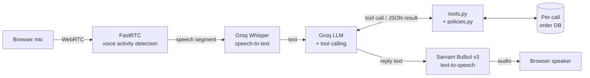

# Aria: AI Voice Customer Support Agent for Aura Skincare

**Live Application:** _coming soon (Hugging Face Spaces link)_

---

## Approach

Aria is a browser-based voice agent built as a modular pipeline: FastRTC streams microphone audio, Groq Whisper transcribes it, a Groq LLM reasons and calls tools, and Sarvam Bulbul speaks the reply in an Indian voice. Brand policies are enforced in Python inside the tools, not only in the prompt. The code makes every policy decision and the LLM only explains it. This keeps the agent from promising refunds or cancellations the policy does not allow.

## Demo Video

_coming soon_

---

## Features

The table maps each part of the build to the assignment's Core Requirements (Section 2).

| Requirement | How it is met | Status |
|---|---|---|
| **A. Voice Conversation** | Real-time mic audio via FastRTC, Groq Whisper STT, Groq LLM, Sarvam Bulbul v3 streaming TTS (Indian voice). Persona "Aria": friendly, professional, concise. Conversation history kept for the whole call. Instant pre-recorded greeting. Unclear or mumbled audio gets "Sorry, I didn't quite catch that" instead of a guessed answer. | ✅ |
| **B. Brand Knowledge & Guardrails** | Aria's prompt is generated from the same constants the policy code uses, so they can't drift apart. Return, damage, cancellation, COD and shipping decisions are made in Python. She refuses exceptions even when the customer insists, declines out-of-scope requests ("book a flight to Goa"), and says "I don't have that information" for anything not in the brief (product claims, refund timelines, offers). | ✅ |
| **C. Tool Calling** | Five tools: `get_order_details`, `check_return_eligibility`, `cancel_order`, plus `check_return_policy` (no order ID, e.g. the brief's "20 days ago, opened" example) and `check_cod_and_shipping` (any amount). Spoken order IDs ("ord 101", "order one zero one") are normalised to `ORD-101`. Cancellation is two-step and confirmation is enforced in code. | ✅ |
| **D. Post-Call Summary** | On End Call the page shows a timestamped, chronological transcript (customer + agent) and a JSON outcome. A **separate LLM call** over the transcript (JSON mode) fills `customer_intent`, `order_id`, `resolution_status` and `call_summary`. Values are validated against allowed lists. Code adds facts it already knows: `actions_taken` (each tool and its decision), `call_duration_seconds`, `customer_turns`. | ✅ |
| **E. Testing Interface** | Start / End Call buttons. Live status badge: **Listening / Thinking / Speaking**, synced to actual audio playback. **Test Orders panel** (ORD-101/102/103 with live relative dates and example phrases). Live conversation view during the call, transcript and summary after it. | ✅ |

**Mock data stays current.** Order dates are computed from the current time (IST) each time a call starts. ORD-102 is always "delivered 14 days ago" and ORD-103 is always "ordered 3 hours ago". ORD-101 is "expected by 6 PM today", which rolls over to 6 PM tomorrow when tested after 6 PM IST, so the promise is never in the past.

**Per-call isolation.** Each call gets its own copy of the order database. Cancelling ORD-103 in one call does not affect the next evaluator.

---

## Architecture



### One conversational turn

1. **FastRTC** streams the microphone over WebRTC. Its `ReplyOnPause` handler runs Silero VAD and fires once the customer stops speaking.
2. **`stt.py`** resamples the speech from 48 kHz to 16 kHz (a 3x smaller upload) and sends it to Groq Whisper. The request includes a spelling hint ("Aria", "Aura Skincare", "ORD-101") so brand words and order IDs come back correctly. Segments Whisper marks as likely silence (`no_speech_prob`) or low confidence (`avg_logprob`) are dropped, so noise and mumbling lead to "could you repeat that?" instead of a hallucinated answer.
3. **`agent.py`** keeps the call's message history and asks the Groq LLM for a reply. Low reasoning effort keeps replies fast.
4. **`tts.py`** calls Sarvam's **streaming** TTS endpoint for raw 24 kHz PCM. Audio is forwarded to the browser in 0.2 s pieces as it arrives, so Aria starts speaking before the whole sentence is synthesised.
5. Each browser call has its own `CallSession`, keyed by FastRTC's `webrtc_id`. It holds that call's history, transcript and order database.

**Measured latency** (end of customer speech → first audio from Aria, on a warm connection):

| Turn type | Total | Breakdown |
|---|---|---|
| Without a tool | **~0.65–0.9 s** | STT ~0.3 s, LLM ~0.2–0.35 s, TTS first audio ~0.2 s |
| With a tool | **~1.4–1.8 s** | Two LLM rounds |

The first turn of a session is slower while connections are opened.

### Live state indicator and post-call summary

- `respond()` sends the page the live transcript and the current state through FastRTC's `AdditionalOutputs`:
  - **Thinking** as soon as the customer pauses
  - **Speaking** when the reply audio starts
  - **Listening** once the reply has finished
- FastRTC queues audio faster than it plays, so `play_and_wait()` holds the reply open until the audio has actually finished playing, plus a 0.4 s margin.
- **Echo protection (barge-in disabled).** Without headphones, the microphone picks up Aria's own voice from the speakers. With interruptions enabled, that echo was detected as customer speech and repeatedly cut Aria off, so replies sounded broken. A WebRTC test with simulated speaker echo reproduced this. `ReplyOnPause(..., can_interrupt=False)` ignores the mic while Aria is speaking. Because `play_and_wait()` tracks real playback time, the mic is muted for exactly as long as she talks. Echo-robust barge-in is listed as a future improvement.
- End Call fires FastRTC's `stop_recording` event. `summary.py` then runs a separate LLM call over the transcript and tool log and returns the JSON outcome. The call's session is then freed.

### Project structure

| File | Role |
|---|---|
| `app.py` | Gradio + FastRTC app: call handling, live updates, end-of-call flow |
| `stt.py` / `tts.py` | Groq Whisper speech-to-text / Sarvam Bulbul streaming text-to-speech |
| `agent.py` | `CallSession`: system prompt, conversation memory, tool-calling loop, model fallback |
| `tools.py` | The 5 tools, their JSON schemas, order ID normalisation, safe dispatcher |
| `policies.py` | Brand policy constants, decision functions, `BRAND_INFO` for the prompt |
| `orders.py` | Mock order database with dates relative to now; one copy per call |
| `summary.py` | Post-call JSON summary (separate LLM call + code-derived facts) |
| `ui.py` | Status badge, Test Orders panel, transcript formatting |
| `config.py` | Settings and API keys from environment variables |
| `test_tools.py` / `test_agent.py` | 47 rule/tool checks / 12 scripted LLM conversations |

### How the agent decides when to use a tool

Every LLM request includes JSON schemas for the five tools (`TOOL_SCHEMAS` in `tools.py`) with `tool_choice="auto"`, so the model decides per turn. Two things guide that decision:

- **Tool descriptions** say when each tool applies, e.g. "use whenever the customer asks about a specific order".
- **A routing section in the system prompt** maps intents to tools: order status → `get_order_details`; return for an order → `check_return_eligibility`; return without an order ID → `check_return_policy`; a specific amount → `check_cod_and_shipping`; no order ID → ask for one, never guess.

The loop in `agent.py` (`CallSession.reply`):

```
customer text → LLM ──(tool_calls?)── no ──→ spoken answer
                  ↑         │ yes
                  │         ↓
                  └── tool results (JSON) ← run_tool() → policies.py
```

At most 3 tool rounds per turn. General brand questions ("Do you have COD?") are answered directly from the brand information in the prompt, without a tool call.

| Customer says | Tool called | Decision (made in code) |
|---|---|---|
| "Where is ORD-101?" | `get_order_details` | Out for Delivery, BlueDart BD-982103, by 6 PM today |
| "Return ORD-102" | `check_return_eligibility` | `RETURN_WINDOW_CLOSED` (14 days > 7) |
| "ORD-102 arrived damaged" | `check_return_eligibility(is_damaged)` | `DAMAGE_REPORT_WINDOW_CLOSED` (> 48 h) |
| "Bought 20 days ago, opened, can I return?" | `check_return_policy` | `RETURN_WINDOW_CLOSED` |
| "Cancel ORD-103" → "Yes" | `cancel_order` → `cancel_order(confirmed)` | Asks to confirm, then `cancelled: true` |
| "Cancel ORD-101" | `cancel_order` | `ALREADY_SHIPPED`; can refuse at doorstep |
| "Check ORD-999" | `get_order_details` | `ORDER_NOT_FOUND`; asks the customer to verify |
| "COD for 3,000 rupees?" | `check_cod_and_shipping` | COD not allowed (limit ₹2,500) |

### How guardrails are enforced

- **Code decides, LLM explains.** `policies.py` holds the rules:
  - 7-day return window for unopened products
  - 48-hour damage reporting
  - cancellation only while the order is Processing
  - free shipping from ₹499
  - COD up to ₹2,500

  The tools return a decision code such as `RETURN_WINDOW_CLOSED` or `ALREADY_SHIPPED` with a reason. The LLM cannot override these decisions.
- **Lesson learned: prompt rules alone were not enough.** During testing the LLM:
  - cancelled an order when the customer only asked "*can* I cancel?"
  - promised a return process after a refused delivery

  Both were fixed in code:
  - `cancel_order` never cancels on the first call. It records that confirmation was requested and only cancels on a second call with `confirmed=true`.
  - Tool results carry a `note_for_agent` that limits what may be offered ("refusing at the doorstep is the ONLY option").
- **Prompt and code share one source of truth.** `policies.BRAND_INFO` is built from the same constants the decision functions use.
- **Scope and honesty rules** in the system prompt cover:
  - Aura Skincare topics only.
  - No product claims or skin advice (the brief has no product data).
  - No invented next steps.
  - Unclear speech → ask the customer to repeat.
- **No invented data.** Fields the brief does not specify are left out of tool results, and unknown order IDs return `ORDER_NOT_FOUND`.
- **Tools never crash.** Bad or unexpected LLM arguments, broken JSON and unknown tool names all return structured errors.
- **Assumption:** the brief says free delivery "above ₹499" and a ₹50 fee "below ₹499", which leaves exactly ₹499 undefined. This build treats ₹499 as free.

---

## Tech Stack

| Component | Choice | Why |
|---|---|---|
| Language | Python 3.11 | One language for the whole app |
| Real-time audio | FastRTC | WebRTC streaming with built-in voice activity detection, integrates directly with Gradio |
| UI | Gradio | Python-only UI, deploys natively on Hugging Face Spaces |
| Speech-to-text | Groq `whisper-large-v3-turbo` | Fastest hosted Whisper: ~0.3 s per turn in testing |
| LLM | Groq `openai/gpt-oss-120b` (`reasoning_effort="low"`) | Supports tool calling, ~0.2–0.35 s per reply in testing. Groq's Llama 3.x models were retired in 2026. |
| Text-to-speech | Sarvam `bulbul:v3`, voice `priya`, `en-IN` | Natural Indian voice; the streaming endpoint gives first audio in ~0.2–0.6 s |
| Hosting | Hugging Face Spaces | Free, public, first-class Gradio support |

All models can be changed in `.env` without code changes (`LLM_MODEL`, `STT_MODEL`, `TTS_SPEAKER`).

**Rate limits.** Groq's free tier allows 200K tokens per day and 8K tokens per minute per model, and a tool-using turn costs about 2.6K tokens. Two things keep calls working through these limits:

- If the main model is rate-limited, the agent automatically falls back to `openai/gpt-oss-20b` (`LLM_FALLBACK_MODEL`).
- The SDK retries short per-minute limits.

The fallback model follows guardrails less strictly, so the production fix is Groq's pay-as-you-go Dev tier.

---

## Setup (run locally)

Requires Python 3.11.

```bash
git clone <your-repo-url>
cd <repo-folder>
python -m venv venv
# Windows:  venv\Scripts\activate
# Mac/Linux: source venv/bin/activate
pip install -r requirements.txt
cp .env.example .env        # then add your API keys
python test_tools.py        # tests tools & policies, no API keys needed
python app.py               # starts the app at http://127.0.0.1:7860
```

Open http://127.0.0.1:7860 in Chrome or Edge, click **Start Call** and allow microphone access. Headphones give the best experience.

## Environment Variables

See [`.env.example`](.env.example).

| Variable | Purpose |
|---|---|
| `GROQ_API_KEY` | Whisper STT and LLM |
| `SARVAM_API_KEY` | Bulbul TTS |
| `HF_TOKEN` | TURN server for WebRTC when deployed on Spaces |
| `LLM_MODEL`, `LLM_FALLBACK_MODEL`, `STT_MODEL`, `TTS_SPEAKER` | Optional overrides (defaults: `openai/gpt-oss-120b`, `openai/gpt-oss-20b`, `whisper-large-v3-turbo`, `priya`) |

## Deployment (Hugging Face Spaces)

The repository is Space-ready: the YAML header at the top of this README configures the Space (Gradio 5.50.0, Python 3.11, `app.py`).

1. Create a new Space (SDK: **Gradio**, hardware: free **CPU basic**).
2. In **Settings → Variables and secrets**, add the secrets `GROQ_API_KEY`, `SARVAM_API_KEY` and `HF_TOKEN`.
3. Push the code to the Space:
   ```bash
   git remote add space https://huggingface.co/spaces/<username>/<space-name>
   git push --force space main
   ```
4. Wait for the build to finish (Logs tab), then open the App tab.

**Why `HF_TOKEN`?** Browsers and the Space server sit behind different networks. WebRTC needs a TURN relay to connect them. On Spaces the app automatically requests fresh TURN credentials for every call from FastRTC's Cloudflare TURN service, authenticated with `HF_TOKEN`. Locally no TURN server is needed.

---

## How to Test

**Test orders**

| Order ID | Customer | Product | Value | Status | Notes |
|---|---|---|---|---|---|
| ORD-101 | Priya Sharma | Vitamin C Serum (30ml) | ₹699 | Out for Delivery | BlueDart BD-982103, expected by 6 PM today |
| ORD-102 | Rahul Verma | Hydrating Sunscreen SPF 50 | ₹499 | Delivered | Delhivery DL-441029, delivered 14 days ago |
| ORD-103 | Ananya Patel | Green Tea Face Wash + Toner | ₹850 | Processing | Ordered 3 hours ago, can be cancelled |

**Things to say**

| You say | Expected behaviour |
|---|---|
| "Where is my order ORD-101?" | Out for delivery with BlueDart, expected by 6 PM today |
| "I want to return ORD-102." | Politely refused: delivered 14 days ago, outside the 7-day window |
| "Please cancel ORD-103." → "Yes" | Asks to confirm, then cancels (it is still Processing) |
| "I bought it 20 days ago and opened it. Can I return it?" | Politely refused (outside the 7-day window) |
| "Please make an exception." | Still refused, no promises |
| "Is your serum good for oily skin?" | "I don't have that information" (no invented product claims) |
| "Cancel ORD-101." | Refused: already out for delivery, can refuse at doorstep |
| "Check order ORD-999." | "I couldn't find that order, could you verify the ID?" |
| "I want to track my order." (no ID) | Asks for the order ID |
| "Can you book me a flight to Goa?" | Politely says it only helps with Aura Skincare queries |
| "Is COD available?" / "Is shipping free?" | Answers from brand policy |

After **End Call**, the transcript and the JSON summary appear under "Post-Call Summary". Example (cancellation call):

```json
{
  "customer_intent": "CANCELLATION",
  "order_id": "ORD-103",
  "resolution_status": "RESOLVED",
  "call_summary": "The customer requested cancellation of order ORD-103, and the agent confirmed and cancelled it successfully.",
  "actions_taken": [
    {"tool": "cancel_order", "outcome": "AWAITING_CONFIRMATION", "order_id": "ORD-103"},
    {"tool": "cancel_order", "outcome": "CANCELLED", "order_id": "ORD-103"}
  ],
  "call_duration_seconds": 17,
  "customer_turns": 2
}
```

**Without voice:**
- `python test_tools.py` runs 47 checks on the tools and policy rules. No API keys needed.
- `python test_agent.py` runs 12 scripted conversations against the real LLM and prints every tool call and result. Use `python test_agent.py 9` to run a single conversation, or `--chat` to type freely.

---

## Tell Us How I Think

> _Draft answers. To be rewritten in my own words._

**1. Why did you choose your particular architecture and technology stack?**
I chose a modular STT → LLM → TTS pipeline over a speech-to-speech model because each step is visible and testable. I can read the transcript, see exactly which tool was called, and enforce policies in normal Python code. Groq gives very low latency for both Whisper and the LLM, and Sarvam Bulbul gives a natural Indian voice. FastRTC + Gradio kept everything in Python and deploys to Hugging Face Spaces in a few steps.

**2. What was the most difficult part of the assignment, and how did you solve it?**
_(draft)_ Making the agent reliably follow the brand policy. Even with clear rules in the prompt, the LLM sometimes:
- cancelled an order when the customer only asked whether they *could* cancel
- promised a return process that doesn't exist
- praised a product it knew nothing about

I solved this by moving decisions out of the prompt and into code:
- the policy functions decide every outcome
- cancellation requires a confirmation step that the code enforces
- tool results tell the model exactly which options it may offer

I verified each fix with a scripted test conversation.

**3. If you had one more week, what would you improve first and why?**
_(draft)_ Stream LLM tokens straight into TTS sentence by sentence, so Aria starts speaking before the full reply is written. TTS audio already streams, but the reply text is still generated in full first. I would also bring back barge-in (interrupting Aria). It is currently disabled because, on laptop speakers, Aria's own voice leaked into the microphone and kept cutting her off. A proper fix would combine stronger echo cancellation with requiring real speech energy above the echo level before interrupting. These two changes have the biggest effect on how natural a call feels.

**4. What would need to change at 1,000 conversations a day?**
_(draft)_
- Replace the in-memory mock data with a real order system API, with customer identity verification.
- Add monitoring of latency, tool errors and escalations.
- Run automated regression tests on recorded conversations.
- Add a human-handoff path.
- Manage API rate limits and cost per call.
- Store transcripts securely, with PII redaction.

---

## Author

**Himanshu Yadav**, [LinkedIn](https://www.linkedin.com/in/himanshu-yadav552003/)
