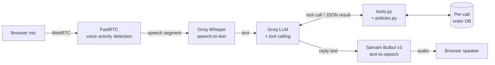

# Aria: AI Voice Customer Support Agent for Aura Skincare

**Live Application:** _coming soon (Hugging Face Spaces link)_

> **Build status:** Step 1 of 7 done (mock data, policy engine, tools). Sections marked _(in progress)_ describe parts that are not built yet.

---

## Approach

Aria is a browser-based voice agent built as a modular pipeline: FastRTC streams microphone audio, Groq Whisper transcribes it, a Groq LLM reasons and calls tools, and Sarvam Bulbul speaks the reply in an Indian voice. Brand policies are enforced in Python inside the tools, not only in the prompt. The code makes every policy decision and the LLM only explains it. This keeps the agent from promising refunds or cancellations the policy does not allow.

## Demo Video

_coming soon_

---

## Features

The table maps each part of the build to the assignment's Core Requirements (Section 2).

| Requirement | How it is met | Status |
|---|---|---|
| **A. Voice Conversation** | Real-time mic audio via FastRTC, Groq Whisper STT, Groq LLM, Sarvam Bulbul v3 TTS (Indian voice). Persona "Aria": friendly, professional, concise. Conversation history kept for the whole call. | _(in progress)_ |
| **B. Brand Knowledge & Guardrails** | All policy numbers live in `policies.py`. Return, damage and cancellation decisions are made in code. Out-of-scope requests are politely declined. Invalid or missing order IDs return structured errors, so the agent asks the customer to verify the ID instead of guessing. | Policy engine ✅ / prompt _(in progress)_ |
| **C. Tool Calling** | `get_order_details`, `check_return_eligibility`, `cancel_order`. Order IDs heard by STT ("ord 101", "order one zero one") are normalised to `ORD-101`. | ✅ |
| **D. Post-Call Summary** | Chronological transcript, plus a JSON outcome (`customer_intent`, `order_id`, `resolution_status`, `call_summary`) from a separate LLM call over the transcript. | _(in progress)_ |
| **E. Testing Interface** | Start / End Call buttons, live Listening / Thinking / Speaking indicator, Test Orders panel, transcript and summary view. | _(in progress)_ |

**Mock data stays current.** Order dates are computed from the current time (IST) each time a call starts. ORD-102 is always "delivered 14 days ago" and ORD-103 is always "ordered 3 hours ago". ORD-101 is "expected by 6 PM today", which rolls over to 6 PM tomorrow when tested after 6 PM IST, so the promise is never in the past.

**Per-call isolation.** Each call gets its own copy of the order database. Cancelling ORD-103 in one call does not affect the next evaluator.

---

## Architecture



### How the agent decides when to use a tool

_(in progress: completed in Step 3)_ The LLM gets JSON schemas for each tool (`TOOL_SCHEMAS` in `tools.py`). The tool descriptions say when each one applies, e.g. "use whenever the customer asks about a specific order". When the model returns a tool call, the app runs it, sends the result back to the model, and the model writes a short spoken reply.

### How guardrails are enforced

- **Code decides, LLM explains.** `policies.py` holds the rules:
  - 7-day return window for unopened products
  - 48-hour damage reporting
  - cancellation only while the order is Processing
  - free shipping from ₹499
  - COD up to ₹2,500

  The tools return a decision code such as `RETURN_WINDOW_CLOSED` or `ALREADY_SHIPPED` with a reason. The LLM cannot override these decisions.
- **No invented data.** Fields the brief does not specify are left out of tool results, and unknown order IDs return `ORDER_NOT_FOUND`.
- **Tools never crash.** Bad or unexpected LLM arguments, broken JSON and unknown tool names all return structured errors.
- **Assumption:** the brief says free delivery "above ₹499" and a ₹50 fee "below ₹499", which leaves exactly ₹499 undefined. This build treats ₹499 as free.

---

## Tech Stack

| Component | Choice | Why |
|---|---|---|
| Language | Python 3.11 | One language for the whole app |
| Real-time audio | FastRTC | WebRTC streaming with built-in voice activity detection, integrates directly with Gradio |
| UI | Gradio | Python-only UI, deploys natively on Hugging Face Spaces |
| Speech-to-text | Groq Whisper | Very fast hosted Whisper inference, keeps turn latency low |
| LLM | Groq-hosted model with tool calling | Low time-to-first-token, OpenAI-compatible tool calling |
| Text-to-speech | Sarvam Bulbul v3 | Natural Indian voices, built for Indian English and Hinglish |
| Hosting | Hugging Face Spaces | Free, public, first-class Gradio support |

_(Exact model names are confirmed against provider docs in Step 2.)_

---

## Setup (run locally)

Requires Python 3.11.

```bash
git clone <your-repo-url>
cd <repo-folder>
python -m venv venv
# Windows:  venv\Scripts\activate
# Mac/Linux: source venv/bin/activate
pip install -r requirements.txt
cp .env.example .env        # then add your API keys
python test_tools.py        # tests tools & policies, no API keys needed
```

_(The command to run the voice app is added in Step 2.)_

## Environment Variables

See [`.env.example`](.env.example).

| Variable | Purpose |
|---|---|
| `GROQ_API_KEY` | Whisper STT and LLM |
| `SARVAM_API_KEY` | Bulbul TTS |
| `HF_TOKEN` | TURN server for WebRTC when deployed on Spaces |

## Deployment

_(in progress: Step 6, Hugging Face Spaces)_

---

## How to Test

**Test orders**

| Order ID | Customer | Product | Value | Status | Notes |
|---|---|---|---|---|---|
| ORD-101 | Priya Sharma | Vitamin C Serum (30ml) | ₹699 | Out for Delivery | BlueDart BD-982103, expected by 6 PM today |
| ORD-102 | Rahul Verma | Hydrating Sunscreen SPF 50 | ₹499 | Delivered | Delhivery DL-441029, delivered 14 days ago |
| ORD-103 | Ananya Patel | Green Tea Face Wash + Toner | ₹850 | Processing | Ordered 3 hours ago, can be cancelled |

**Things to say**

| You say | Expected behaviour |
|---|---|
| "Where is my order ORD-101?" | Out for delivery with BlueDart, expected by 6 PM today |
| "I want to return ORD-102." | Politely refused: delivered 14 days ago, outside the 7-day window |
| "Please cancel ORD-103." | Cancelled (it is still Processing) |
| "Cancel ORD-101." | Refused: already out for delivery, can refuse at doorstep |
| "Check order ORD-999." | "I couldn't find that order, could you verify the ID?" |
| "I want to track my order." (no ID) | Asks for the order ID |
| "Can you book me a flight to Goa?" | Politely says it only helps with Aura Skincare queries |
| "Is COD available?" / "Is shipping free?" | Answers from brand policy |

**Without voice:** `python test_tools.py` runs 36 checks on the tools and policy rules.

---

## Tell Us How I Think

> _Draft answers. To be rewritten in my own words._

**1. Why did you choose your particular architecture and technology stack?**
I chose a modular STT → LLM → TTS pipeline over a speech-to-speech model because each step is visible and testable. I can read the transcript, see exactly which tool was called, and enforce policies in normal Python code. Groq gives very low latency for both Whisper and the LLM, and Sarvam Bulbul gives a natural Indian voice. FastRTC + Gradio kept everything in Python and deploys to Hugging Face Spaces in a few steps.

**2. What was the most difficult part of the assignment, and how did you solve it?**
_(to be filled in after building: likely candidates are latency tuning or reliable tool calling from noisy speech input)_

**3. If you had one more week, what would you improve first and why?**
_(draft)_ Streaming TTS sentence by sentence, so Aria starts speaking before the full reply is ready, plus barge-in so customers can interrupt. These two changes have the biggest effect on how natural a call feels.

**4. What would need to change at 1,000 conversations a day?**
_(draft)_
- Replace the in-memory mock data with a real order system API, with customer identity verification.
- Add monitoring of latency, tool errors and escalations.
- Run automated regression tests on recorded conversations.
- Add a human-handoff path.
- Manage API rate limits and cost per call.
- Store transcripts securely, with PII redaction.

---

## Author

**Himanshu Yadav**, [LinkedIn](https://www.linkedin.com/in/your-profile)
